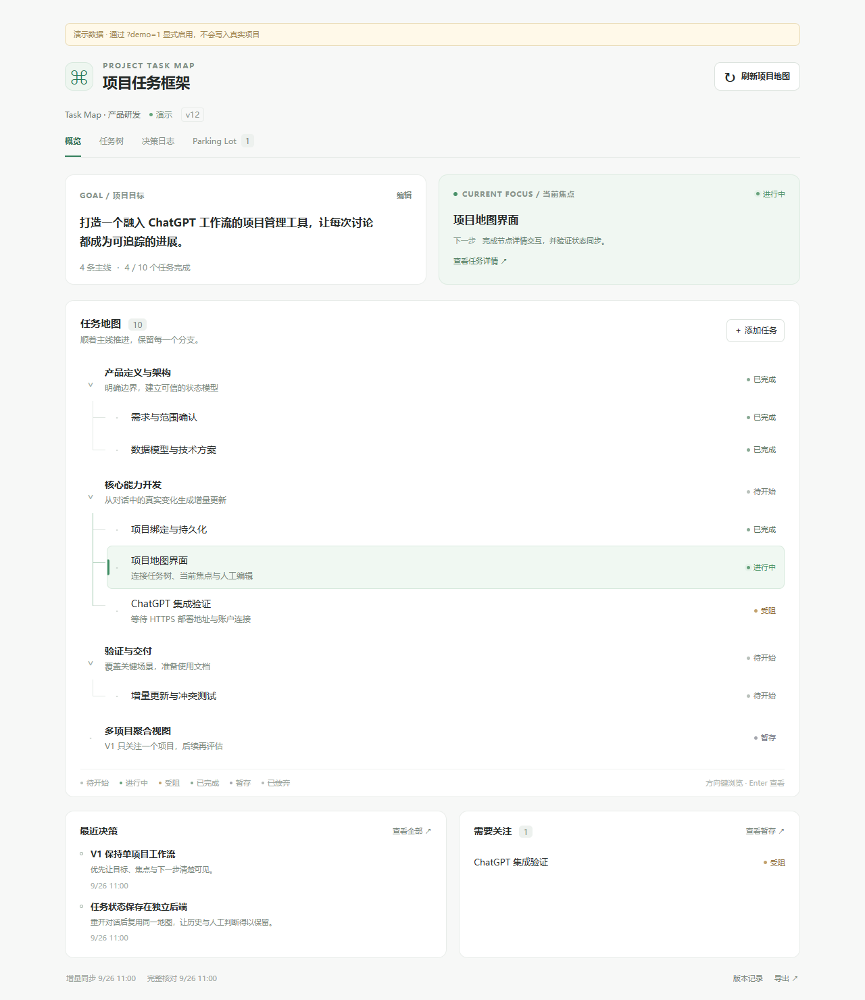

# V1 产品验收记录

验收日期：2026-09-26。交付范围：可运行、可持久化、具备真实 MCP Apps/OAuth 接口的个人部署应用。尚未在用户真实 ChatGPT Pro 账号中完成托管接入，不能描述为已上线的 ChatGPT 产品。

## 本地验收结果

| 检查 | 实际结果 |
|---|---|
| TypeScript | `npm run typecheck` 通过。 |
| 单元与集成 | `npm test`：5 个测试文件，56 项通过。 |
| 构建 | React 自包含 HTML + Node backend 构建成功。仅依赖内 PURE 注释产生非阻塞 Rollup 提示。 |
| 真实浏览器 | Chrome / Playwright，2 项端到端测试通过，退出码 0。 |
| 依赖审计 | 最终完整依赖安装审计及生产依赖 `npm audit --omit=dev` 均为 0 vulnerabilities。 |
| Skill | 官方 `quick_validate.py` 通过。 |
| 备份工具 | 已用开启 WAL 的实际 SQLite 文件验证在线备份数据一致性，并确认拒绝覆盖已有目标。 |
| 独立代码审查 | 六项发现已修复，见 [记录](code-review.md)。 |

浏览器测试从空状态开始，输入实际 owner 凭据与绑定 key，创建任务，确认后端 SQLite 保存和人工保护，调用认证导出端点，并重新加载后以同一 key 找回状态。没有用预制 HTML 冒充保存流程。

## 用户指定的行为场景

| 场景 | 实现与证据 |
|---|---|
| A：20轮只有4轮变化 | Store 测试提供20份结构化判定，仅4次状态修订；NO_OP 还检查 SQLite data_version 没变。 |
| B：“之后再看” | Skill 将明确推迟映射为 parking，结构化 assessment 测试验证不会成为 active。这里测试的是判定契约，不是端到端自然语言模型准确率。 |
| C：已完成任务再次被提到 | 规范化身份去重、终态保护与重复新增回归通过。 |
| D：人工 DROPPED 不被旧对话激活 | Domain/store 与 HTTP 源伪装测试通过，原状态保留并生成待审。 |
| E：关闭10轮后补偿 | 显式 overview reconcile 恢复变化；遗漏项保留，稳定 ID 不变，不访问隐藏聊天。 |
| F：输出概况并更新 TaskBoardApp | UI 测试验证刷新向宿主发送概况+reconcile请求，并保持等待状态；store/MCP验证合并管道。本地未调用真实 ChatGPT 模型生成概况。 |

另外覆盖父/依赖环、缺失端点、前置条件、焦点唯一性、原子性、同键不同载荷、过期版本、人工锁、证据过期、时间单调、回滚防复活、跨 owner/project 隔离、重启恢复、OAuth PKCE、iframe origin、host metadata兼容封装、异步项目切换竞态、导出转义与 UI 错误保留输入。

## 八个问题的可见性

| 用户需要知道 | UI 位置 |
|---|---|
| 最终要做什么 | 顶部 Goal 卡片。 |
| 正在做什么 | Current Focus 卡片与绿色当前分支。 |
| 下一步 | Current Focus 的明确 nextStep；缺失时说明需要补充。 |
| 已完成什么 | 任务树“已完成”文本状态与总体完成数。 |
| 哪些卡住 | “受阻”状态与概览的“需要关注”。 |
| 哪些暂缓 | Parking Lot 数量、独立页签和树中状态。 |
| 之前做过哪些决策 | 概览最近决策与完整决策日志。 |
| 多少主要分支 | Goal 卡片主线计数及顶层树节点。 |

已用桌面和390px宽度截图检查层级、连接线、当前分支、阅读顺序及无水平溢出，修复了错误的全局 focus outline 和过小字号。**没有进行有参与者的10秒可用性研究**，这里只证明八类信息明确可见；真实复杂项目中的认知时间仍需实测。

截图使用明确标记的演示状态以展示完整结构；正式默认界面是空项目绑定页。实际持久化由另一条浏览器测试验证。[窄屏截图](images/task-map-mobile.png)。

## 发布边界和下一步

仍需操作者提供 HTTPS origin/部署环境，完成真实 Pro 账号 OAuth 与 iframe CSP/CORS 联调，并以真实项目逐步验证语义判断与补偿效果。普通 Chat 无可靠逐轮回调，完整历史不可枚举，宿主级页签接口未公开；这些不是本地代码可以凭空实现的能力。详情见 [CURRENT_LIMITATIONS](../CURRENT_LIMITATIONS.md) 和 [接入指南](chatgpt-connection.md)。

源码、接入步骤和已执行测试可以交付；不能据此宣称“任意 ChatGPT Project 已无感全自动同步”。
